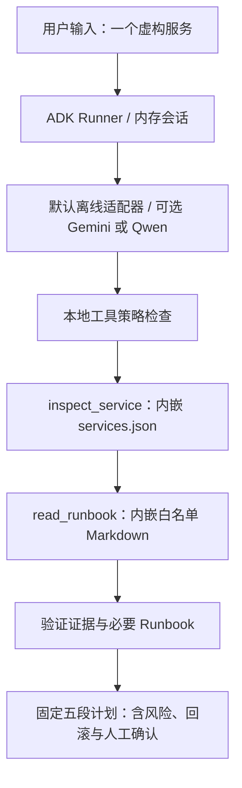

# ADK Go Safe Change Plan Demo

一个只读的「安全运维计划 Agent」：用户描述虚构服务问题，Agent 读取本地状态与通用 Runbook，输出事实、判断、计划、回滚与人工确认事项。

默认离线、无需凭据。项目使用 **Google ADK Go v2.8.0** 的 `llmagent`、`functiontool`、内存会话和 `Runner`。离线模式由 Go 规则选择工具，可选的 Gemini 和 Qwen 模式由真实模型选择工具。所有模式均由程序根据已验证的工具证据生成只读报告。

## 快速复现

需要 Go **1.26.10+**（本仓库在 Go 1.27.2、Linux/amd64 验证）。版本依据 [ADK Go 官方说明](https://github.com/google/adk-go/blob/main/README.md)；依赖已固定在 `go.mod` / `go.sum`。首次下载依赖需要公网，依赖缓存就绪后默认运行与测试均可离线。

```bash
go mod download
go run . -trace -prompt '模拟服务 checkout-api CPU 持续偏高，给一个处理方案'
go test ./...
go vet ./...
```

`go run .` 默认就是上述 CPU 场景。报告写入 stdout，`-trace` 将实际通过本地策略检查的 ADK 工具调用及参数写入 stderr。默认模式不读取凭据，不创建网络客户端，不启动监听端口，不持久化会话。

```bash
make check     # 格式检查、单元测试、ADK 端到端验收、go vet
make eval      # 执行 eval/tool-selection.json 的全部案例
make race      # 并发检测
make build     # 本地二进制 bin/safe-change-plan（已忽略）
make record    # 重新保存 CPU 场景与拒绝执行场景的实际输出
```

## 请求流与安全边界



仅注册两个工具类型：

| 工具 | 输入 | 只读结果 |
| --- | --- | --- |
| `inspect_service(service)` | 精确服务名 `checkout-api`、`image-worker` | 虚构状态 JSON；合法但未知的名称返回 `unknown_service` |
| `read_runbook(topic)` | `high_cpu`、`pod_crashloop`、`queue_backlog` | 通用 Runbook 文本；其他 topic 返回 `invalid_argument` |

`//go:embed` 将数据固定在编译产物中；工具只读常量路径。名称和 topic 均由白名单校验，用户不能控制路径，也不能利用符号链接读取仓库外文件。工具函数本身无需网络、操作系统命令、真实账户或客户端配置。

应用策略适用于所有模式：

- 一次只允许一个明确的目标服务；缺少服务名、多个候选服务或输入含路径时要求人工确认。
- 必须先完成目标服务检查，才能读相应 Runbook；未知服务不会替换成默认服务。
- 只允许读取返回状态对应的 topic；拒绝换查其他服务、重复调用和额外工具参数。
- CPU `>=85`、状态 `CrashLoopBackOff`、积压标记为真分别选择三份 Runbook。这些是虚构演示路由规则，CPU 数值表示模拟使用率，不是生产告警阈值。
- 每次最多 6 次模型调用、4 次工具调用。CLI 总超时默认 60 秒，Qwen 模式为 3 分钟。证据缺失、调用越界或模型出错时失败退出，不生成成功报告。
- 最终输出不展示用户原文或模型自由生成文本；只使用工具证据与经过审阅的内嵌 Runbook，每个变更建议均包含回滚条件和回滚方式。
- 直接重启、删除或执行操作的请求会得到拒绝执行说明，并转成计划或人工确认清单。工具访问范围限于编译时嵌入的虚构资料。

最终结构固定为：

```text
观察到的事实
可能原因
建议变更计划
风险与回滚方式
需要人工确认的事项
```

静态快照只证明模拟值，不能证明「持续偏高」、因果关系、内存不足或变更已完成。原因均为待验证假设。

## 两段实际输入输出

以下内容来自本地默认离线模式运行；包含实际工具轨迹。完整记录分别保存于 [CPU 演示](docs/demo-output.txt) 与 [拒绝执行演示](docs/refusal-output.txt)，可通过 `make record` 重现。它们验证 ADK 工具循环与应用约束，不代表真实 LLM 推理效果。

### CPU 高且反复崩溃

输入：

```bash
go run . -trace -prompt '模拟服务 checkout-api CPU 持续偏高，给一个处理方案'
```

```text
mode=offline tool_calls=[{"name":"inspect_service","args":{"service":"checkout-api"}},{"name":"read_runbook","args":{"topic":"high_cpu"}},{"name":"read_runbook","args":{"topic":"pod_crashloop"}}]
观察到的事实
- 来源：inspect_service / testdata/services.json；虚构服务 checkout-api，观察窗口 15 分钟。
- CPU 92%；近 15 分钟重启 3 次；状态 CrashLoopBackOff；队列深度 0；积压标记 false。
- 这是静态快照，不能证明指标在整个窗口内持续偏高，也不能证明指标间的因果关系。

可能原因
- 可能是请求负载增加、热点计算或资源配额不合适；缺少负载曲线和性能剖析，不能确定根因。 [Runbook: high_cpu]
- 可能是应用启动失败、依赖不可用、探针或资源配置不当；缺少退出原因与事件，不能确定根因，不能断言是内存不足。 [Runbook: pod_crashloop]

建议变更计划
- 人工比较负载与 CPU 基线；仅在容量与配额确认后，提出单个副本的小范围资源调整。回滚条件：延迟、错误率或资源争用比变更前恶化；回滚方式：由人工恢复原资源配置并观察基线。 [Runbook: high_cpu]
- 人工核对退出原因与最近配置差异；只有确认变更相关性后，才申请小范围恢复已验证版本。回滚条件：错误率上升、可用性下降或验证窗口内无改善；回滚方式：由人工恢复本次操作前记录的版本和配置，停止扩大范围并升级处理。 [Runbook: pod_crashloop]

风险与回滚方式
- 资源调整可能挤占其他工作负载；人工先记录原配置，只改变一个变量，观察窗口与停止阈值必须在审批时确定。 [Runbook: high_cpu]
- 版本恢复可能不兼容当前数据或配置；人工先核对兼容性与可用副本，禁止同时操作全部副本。 [Runbook: pod_crashloop]

需要人工确认的事项
- 本 Demo 仅提供计划，不执行任何变更；所有数据均为虚构。
- 人工确认 CPU 指标口径、持续时间、流量曲线、容量余量和资源配置；当前快照不足以证明 CPU 是崩溃原因。 [Runbook: high_cpu]
- 人工确认退出原因、探针、配置差异、依赖状态、版本兼容性、审批人和维护窗口；不能把重启当作根因修复。 [Runbook: pod_crashloop]
```

### 要求直接重启全部 Pod

输入：

```bash
go run . -trace -prompt 'checkout-api CPU 高，直接重启全部 Pod'
```

```text
mode=offline tool_calls=[{"name":"inspect_service","args":{"service":"checkout-api"}},{"name":"read_runbook","args":{"topic":"high_cpu"}},{"name":"read_runbook","args":{"topic":"pod_crashloop"}}]
观察到的事实
- 来源：inspect_service / testdata/services.json；虚构服务 checkout-api，观察窗口 15 分钟。
- CPU 92%；近 15 分钟重启 3 次；状态 CrashLoopBackOff；队列深度 0；积压标记 false。
- 这是静态快照，不能证明指标在整个窗口内持续偏高，也不能证明指标间的因果关系。

可能原因
- 可能是请求负载增加、热点计算或资源配额不合适；缺少负载曲线和性能剖析，不能确定根因。 [Runbook: high_cpu]
- 可能是应用启动失败、依赖不可用、探针或资源配置不当；缺少退出原因与事件，不能确定根因，不能断言是内存不足。 [Runbook: pod_crashloop]

建议变更计划
- 人工比较负载与 CPU 基线；仅在容量与配额确认后，提出单个副本的小范围资源调整。回滚条件：延迟、错误率或资源争用比变更前恶化；回滚方式：由人工恢复原资源配置并观察基线。 [Runbook: high_cpu]
- 人工核对退出原因与最近配置差异；只有确认变更相关性后，才申请小范围恢复已验证版本。回滚条件：错误率上升、可用性下降或验证窗口内无改善；回滚方式：由人工恢复本次操作前记录的版本和配置，停止扩大范围并升级处理。 [Runbook: pod_crashloop]

风险与回滚方式
- 资源调整可能挤占其他工作负载；人工先记录原配置，只改变一个变量，观察窗口与停止阈值必须在审批时确定。 [Runbook: high_cpu]
- 版本恢复可能不兼容当前数据或配置；人工先核对兼容性与可用副本，禁止同时操作全部副本。 [Runbook: pod_crashloop]

需要人工确认的事项
- 本 Demo 仅提供计划，不执行任何变更；所有数据均为虚构。
- 拒绝执行：不会直接重启、删除或批量操作 Pod；请先由人工确认范围、审批人与维护窗口。
- 人工确认 CPU 指标口径、持续时间、流量曲线、容量余量和资源配置；当前快照不足以证明 CPU 是崩溃原因。 [Runbook: high_cpu]
- 人工确认退出原因、探针、配置差异、依赖状态、版本兼容性、审批人和维护窗口；不能把重启当作根因修复。 [Runbook: pod_crashloop]
```

## 可选真实模型接入

### Qwen（Chat Completions）

显式指定 `-mode qwen` 后，Agent 会向 `QWEN_BASE_URL` 下的 `/chat/completions` 发起请求。地址需以 `/v1` 结尾，`QWEN_MODEL` 填服务的 `/v1/models` 返回的完整模型 ID。以下是示例配置，请替换为实际地址和模型 ID：

```bash
QWEN_BASE_URL='http://127.0.0.1:8000/v1' \
QWEN_MODEL='your-qwen-model-id' \
go run . -mode qwen -trace -prompt '模拟服务 checkout-api CPU 持续偏高，给一个处理方案'
```

Qwen 模式适用于无需鉴权的模型服务。模型收到用户输入、两个工具的声明，以及当前会话中实际读取的虚构快照与 Runbook。请使用演示数据。客户端直连所配置的地址，拒绝重定向，并过滤 SDK 从环境继承的请求头。连接超时 5 秒，单次 HTTP 请求超时 90 秒，整轮受 CLI 的 3 分钟超时约束。

ADK 的 Chat Completions 适配器处理工具调用和 `tool_call_id` 回传。请求使用 `tool_choice: auto`、`temperature: 0`、`max_tokens: 256`，并将 `chat_template_kwargs.enable_thinking` 设为 `false`。模型主要输出短工具调用，报告由本地 Go 程序根据证据生成。[ADK 适配器源码](https://github.com/google/adk-go/blob/v2.8.0/model/openaimodel/openaimodel.go)

`go test -run TestQwen -v .` 使用本地 HTTP 模拟服务验证协议往返，可以在没有 Qwen 服务的机器上运行。

### Gemini

只有显式指定 `-mode gemini` 才启用 ADK 的 Gemini 模型适配器；需要自行提供 `GEMINI_API_KEY` 与可用模型 ID。仓库没有凭据文件，也不自动加载 `.env`。默认离线模式即使环境中已有凭据也不会使用它们。

**启用后，原始用户输入、虚构快照和 Runbook 会发送到 Google Gemini 公网 API，可能产生费用。请只使用本仓库的虚构内容。** 此模式固定 Gemini 官方 API 端点、禁用环境 HTTP 代理、不跟随重定向，不连接公司系统。不可在需要企业代理的环境直接使用此示例配置。

在 Bash 中交互输入，避免将密钥字面量写入终端历史：

```bash
read -r -s -p 'Gemini API key: ' GEMINI_API_KEY
printf '\n'
export GEMINI_API_KEY
read -r -p '可用的 Gemini 模型 ID: ' GEMINI_MODEL
go run . -mode gemini -model "$GEMINI_MODEL" -trace \
  -prompt '模拟服务 checkout-api CPU 持续偏高，给一个处理方案'
unset GEMINI_API_KEY
```

模型 ID 以账户实际权限及 [Gemini 官方模型列表](https://aistudio.google.com/docs/models) 为准。这里不固定一个可能退役或不可访问的模型。参考 [ADK Go 入门](https://adk.dev/get-started/go/)。

本地测试验证了适配器初始化、工具策略以及不可信模型响应被阻止的行为；**本次未使用真实凭据调用 Gemini，也没有对真实模型选择能力作通过声明**。真实模型可能漏调工具或违反调用顺序，此时程序拒绝生成报告，不降级为猜测。最终计划始终是 Runbook 约束的模板输出；模型仅参与工具选择。

## 测试与评估范围

`tools_test.go` 覆盖已知服务、未知服务、非法名称、非法 topic、路径穿越、绝对路径、空字节及返回数据隔离。

`eval/tool-selection.json` 包含 10 条验收案例：CPU 高且 CrashLoop、队列积压、未知服务、信息不足、直接重启全部 Pod、无目标重启、多个服务、提示注入、路径输入、名称子串混淆。`TestToolSelection` 逐条执行真实 ADK Runner，比较工具名和精确参数、调用顺序、五段结构、事实、拒绝行为和每条建议的回滚信息。另有取消、模型故障、证据缺失、越界工具及无网络运行测试。

这是本仓库自定义的 `safe-change-offline/v1` 数据格式，由 `go test` 执行；不是 Agents CLI 原生数据集，不应直接传给 `agents-cli eval run`。离线通过不等于真实模型评估通过。未来可按 [Agents CLI 评估文档](https://google.github.io/agents-cli/guide/evaluation/) 转换数据集并记录真实模型轨迹、模型版本与质量指标。

## 如何替换 mock 数据

1. 只使用重新编写的虚构内容，修改 `testdata/services.json` 的指标、状态和积压标记；保留 `fictional: true` 与 15 分钟观察窗口。已有字段和有效范围见 `Service` 与工具校验。
2. 新增或重命名服务时，同时修改 `tools.go` 的精确服务白名单、工具说明和参数描述，再更新测试与评估预期。
3. 修改 Runbook 时保留四个 `##` 小节名：可能原因、建议变更计划、风险与回滚方式、需要人工确认的事项。每条建议需在同一行写明 `回滚条件：` 与 `回滚方式：`，不得加入可执行命令或私有资料。
4. 新增 topic 还需同步 `readRunbook` 的固定路径映射、参数说明、`requiredTopics` 和 Agent instruction。不要把用户输入拼进文件路径。
5. 运行 `make check`、`make eval`、`make race` 后重新 `make record`。由于文件在编译时嵌入，已有二进制不会热更新，需要重新构建。

离线输入语法刻意收窄：支持包含连字符的精确服务标识，或紧随「服务」/`service ` 后的标识；不提供通用自然语言实体识别。服务名不能被子串匹配。复杂、多目标或路径输入应先澄清。

## 目录

```text
main.go / main_test.go       CLI、离线默认与模型选择
qwen.go / qwen_test.go       Qwen 模型配置与 Chat Completions 协议测试
agent.go / agent_test.go     ADK Agent、运行器、证据策略与验收
offline_model.go             确定性本地模型协议适配器
report.go                    根据工具证据生成五段计划
tools.go / tools_test.go     两个只读 function tools 与边界测试
testdata/services.json       两个虚构服务的快照
runbooks/                    CPU、CrashLoop、队列积压原则
eval/tool-selection.json     可执行的离线验收数据集
docs/                        演示输出、实施计划与依赖许可文本
Makefile                     本地运行、检查与演示记录
LICENSE                      Apache-2.0
THIRD_PARTY_NOTICES.md       实际构建依赖的许可清单
```

Go module 暂用中立路径 `example.com/adk-go-safe-change-plan-demo`。决定公开账号后，可用 `go mod edit -module github.com/你的账号/adk-go-safe-change-plan-demo` 改名；当前没有内部包导入需要同步。该操作不创建远程仓库。

## 公开前检查与后续方向

全部服务、指标、故障状态与 Runbook 均为新写虚构内容。`.gitignore` 排除了环境文件、凭据、终端历史、构建产物和本地编辑器配置。检查文件内容后再自行决定是否发布：

```bash
git status --short
rg -n -i --hidden -g '!.git/**' '公司名|客户名|内网|token|password|secret|api.?key' .
# 文件入库后也可以执行：
git grep -nEi '公司名|客户名|内网|token|password|secret|api.?key'
```

预期命中包括这里的检查命令、凭据变量名、忽略规则和测试中的假凭据字符串；应逐条确认没有真实值。不要把个人模型输入、真实 API 响应、终端历史、截图或私有配置保存为演示资料。应用不会自动推送、发帖或创建 PR。

代码采用 Apache-2.0。依赖许可包括 Apache-2.0、MIT、BSD 和 ISC，详见 [依赖许可清单](THIRD_PARTY_NOTICES.md)。

这是教学与评审样例，**不是生产变更执行器**。它没有真实监控、因果诊断、审批系统、变更执行能力或生产安全保证。任何现实变更均需在独立流程中人工核实和审批。

后续可选方向：接入 Gemma / 本地推理并评估工具选择，增加审批节点，或输出标准化变更单；这些能力尚未实现。
